# Relay | Customer Support Desk

Relay is a frontend-only customer support workspace for reviewing conversations, managing customer records, and tracking team workload. It uses seeded demo data and session state to demonstrate a complete support workflow without a backend.

**Live demo:** [https://a2rp.github.io/customer-support-desk/](https://a2rp.github.io/customer-support-desk/)

## Pages

- **Inbox** (`/inbox`) - Review conversation queues, search tickets, open a thread, reply to customers, add private notes, choose saved replies, change priority or status, and assign a teammate.
- **Customers** (`/customers`) - Search, filter, and sort customer records; inspect support history; add or edit a customer; create a ticket for that customer; export the current directory view; or remove a customer and their linked tickets.
- **Reports** (`/reports`) - Review ticket volume, status mix, channels, response coverage, agent workload, and common topics. Date range changes and CSV export use the current ticket data.
- **Not found** - A recovery page appears for an unknown route and links back to the inbox or customer directory.

The root route redirects to the inbox. The top search covers tickets and customers. Select the agent profile at the bottom of the sidebar to change the working agent or turn SLA timers and new ticket auto-assignment on or off. The navigation drawer supports narrow screens and closes with Escape.

## Working with the demo

1. Open a queue or search for a ticket or customer.
2. Select a conversation to read the thread, set its priority, status, and assignee, then send a public reply or add an internal note.
3. Use **New ticket** to create a conversation. The form checks the customer, subject, and first message before it adds the ticket to the inbox.
4. Use **Customers** to add or edit contact details, review recent conversations, and start a ticket with the customer preselected.
5. Use **Reports** to review the same ticket data and download a CSV export.
6. Confirm ticket or customer removal in the custom dialog. Removing a customer also removes their linked tickets from this demo workspace.

The UI uses React state in memory for records, preferences, notifications, and dialogs. Changes are shared across pages while the tab remains open, then reset to the sample data when the page is refreshed. The app does not use browser storage or a backend. Replies and notes are displayed in the demo only; no message is sent to a real customer or external service. CSV export downloads the records currently shown in the selected report or directory view.

## Screenshots

The screenshots below were captured from the production build with representative demo data.

### Pages

| Page | Screenshot |
| --- | --- |
| Inbox and selected conversation | 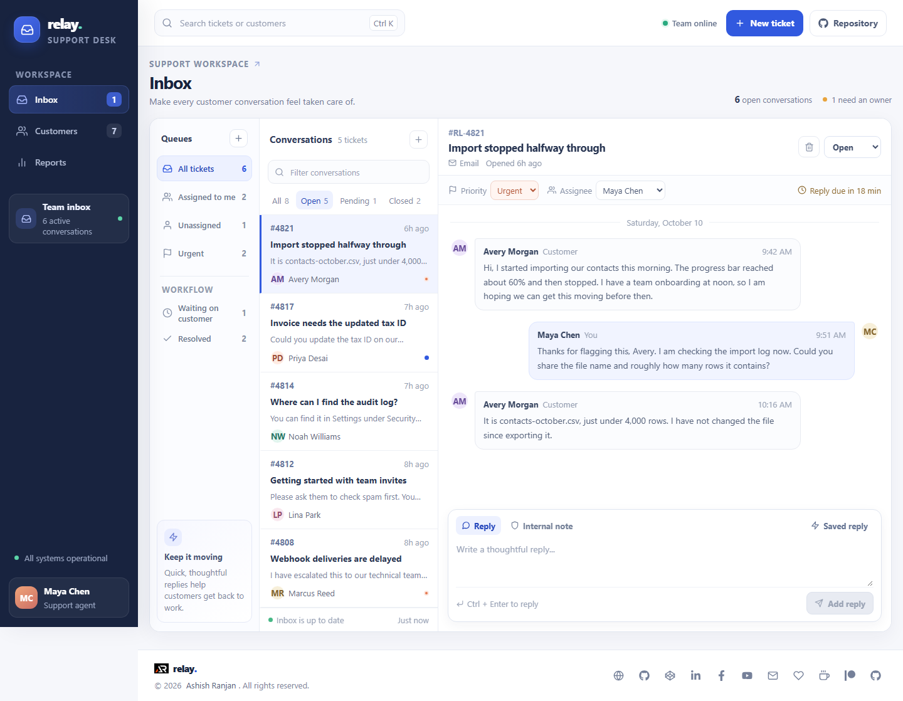 |
| Customer directory |  |
| Customer profile detail | 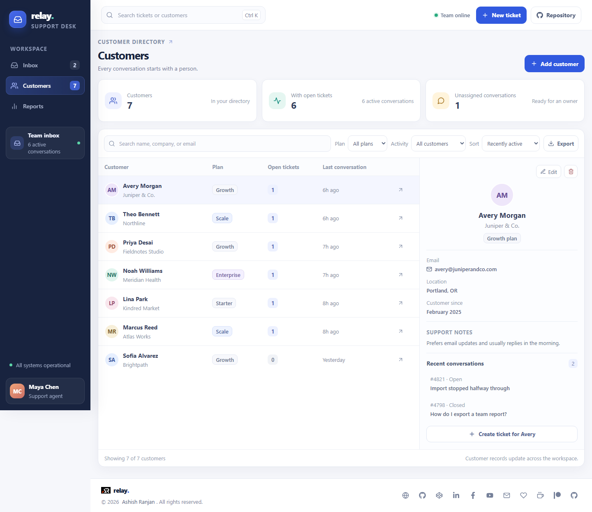 |
| Support reports | 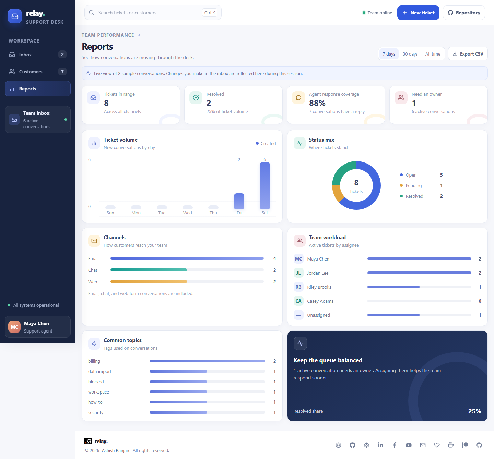 |
| Not found route | 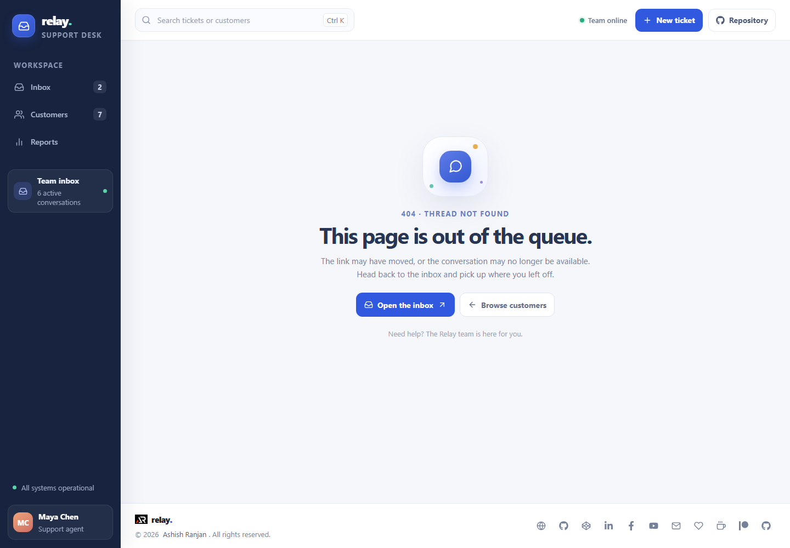 |
| Customer directory on a phone | 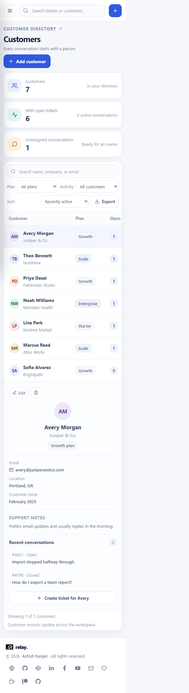 |

### Dialogs

| Dialog | Screenshot |
| --- | --- |
| Create a ticket | 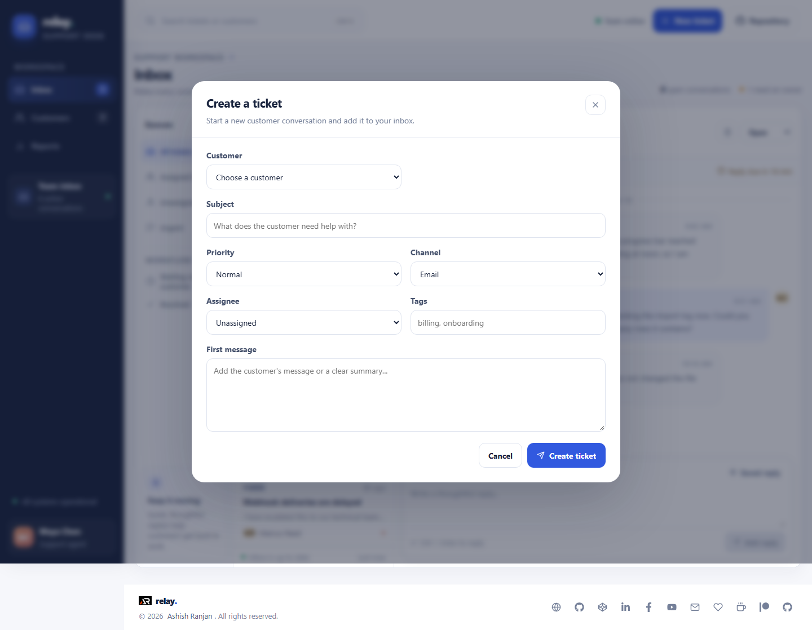 |
| Confirm ticket removal | 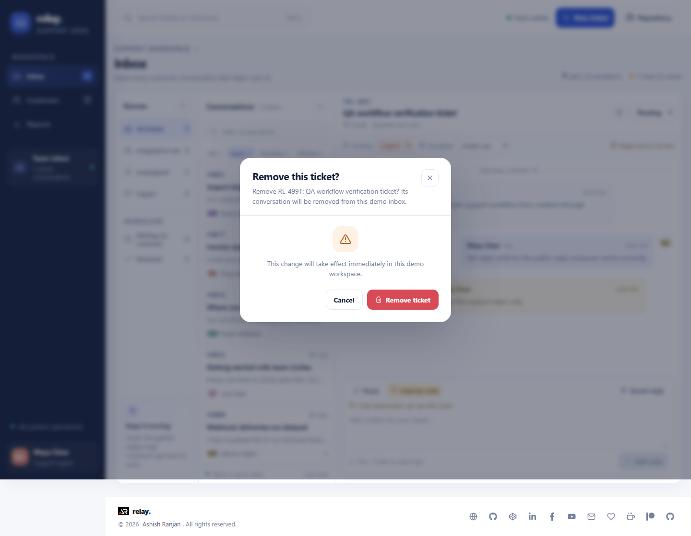 |
| Add a customer | 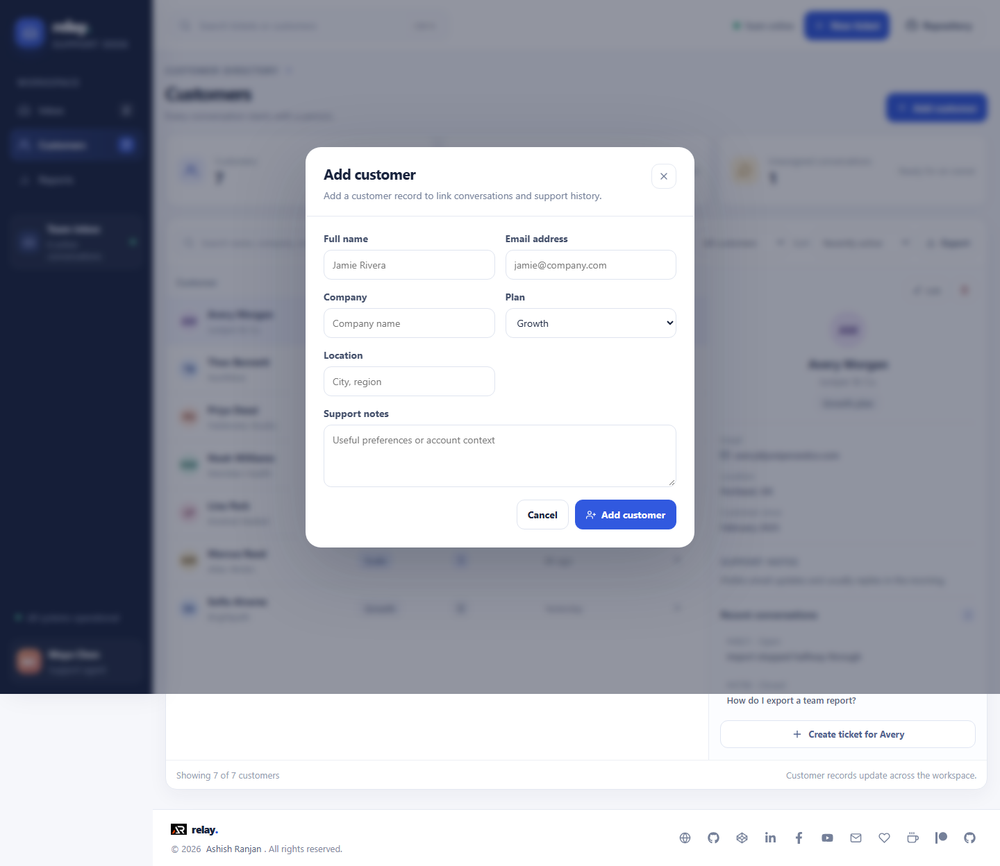 |
| Edit a customer | 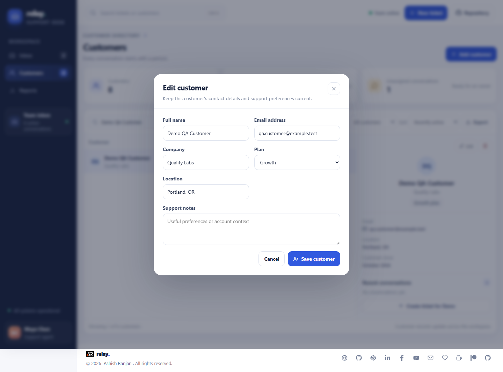 |
| Confirm customer removal | 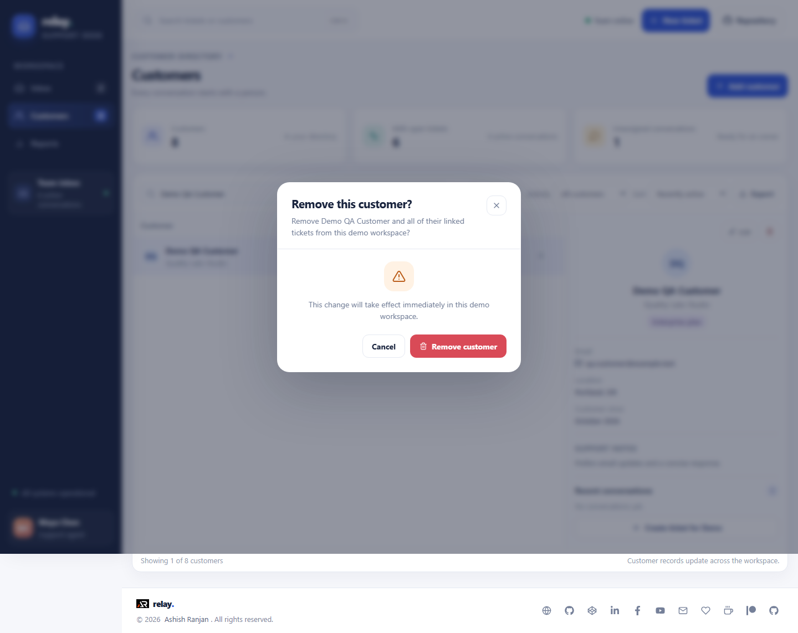 |
| Agent preferences | 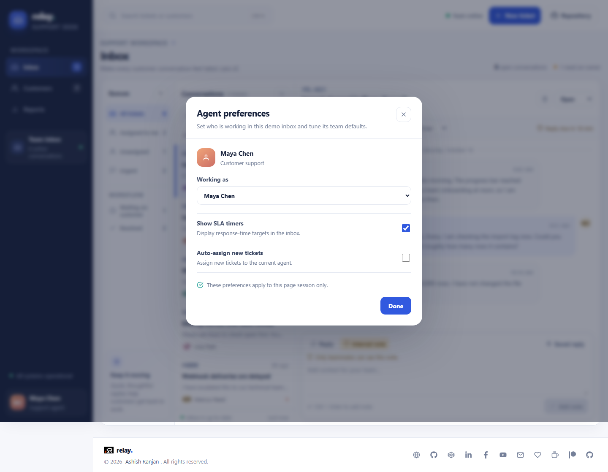 |

## Run locally

```sh
npm install
npm run dev
```

Check the app before publishing:

```sh
npm run lint
npm run build
```

The production build is written to `dist/`. The project is configured for GitHub Pages deployment from the `gh-pages` branch, without a GitHub Actions workflow:

```sh
npm run deploy
```

## Future improvements

These are backend or production extensions and are not implemented in this frontend demo:

- Add shared server storage, team accounts, and permission levels so records can be used by a real support team.
- Connect real email, chat, and web form channels, with delivery state and synchronization handled by a backend.
- Add secure hosted attachments and server-side retention controls for customer files.
- Add a server-backed audit history and reports across multiple agents and workspaces.

## Links

- Portfolio: [https://www.ashishranjan.net](https://www.ashishranjan.net)
- GitHub: [https://github.com/a2rp](https://github.com/a2rp)
- CodePen: [https://codepen.io/ash1198](https://codepen.io/ash1198)
- LinkedIn: [https://www.linkedin.com/in/aashishranjan](https://www.linkedin.com/in/aashishranjan)
- Facebook: [https://www.facebook.com/theash.ashish/](https://www.facebook.com/theash.ashish/)
- YouTube: [https://www.youtube.com/@ashishranjan-ashz?sub_confirmation=1](https://www.youtube.com/@ashishranjan-ashz?sub_confirmation=1)
- Email: [mailto:ash.ranjan09@gmail.com](mailto:ash.ranjan09@gmail.com)

## Support

- Support: [https://a2rp-donation-page.netlify.app/](https://a2rp-donation-page.netlify.app/)
- Buy Me a Coffee: [https://buymeacoffee.com/ashishranjan](https://buymeacoffee.com/ashishranjan)
- Patreon: [https://www.patreon.com/ashishranjan](https://www.patreon.com/ashishranjan)
